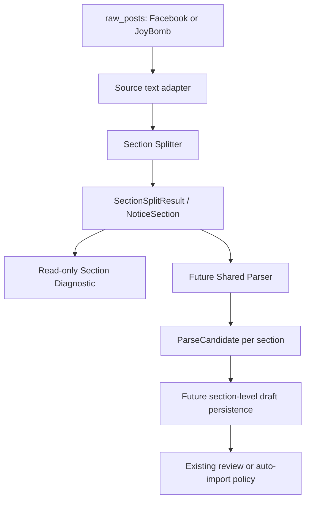

# Section Split Audit And Parse Identity Design

> Scope: read-only audit performed on 2026-07-16.  All section boundaries in
> this report come directly from `content.section_splitter.split_notice_sections`.
> This report does not invoke the Parser and does not create drafts, events, or
> announcement jobs.

## Method

- JoyBomb 2017-2019: 20 notices selected evenly by `published_at` from 262 raw
  posts in the period.
- JoyBomb 2020-2023: 20 notices selected evenly by `published_at` from 309 raw
  posts in the period.
- Facebook: 20 posts selected evenly by `COALESCE(published_at, scraped_at)`
  from 66 raw posts.
- `Notice ID` is the second component of JoyBomb `source_post_id`
  (`section:notice_id`). Facebook has no JoyBomb notice ID.
- Section notation is `index:heading@start_line-end_line/split_reason`; `-`
  means the splitter supplied no heading.

Manual labels:

- **OK-single**: the notice should remain one section.
- **OK-multi**: the explicit headings represent useful separate source blocks.
- **Missed**: independent source blocks exist, but the current splitter did
  not identify the boundary.
- **Source-label anomaly**: the splitter preserved a source heading that is
  duplicated or imperfect; it did not invent a boundary.

## JoyBomb 2017-2019

| Raw post | Source | Notice ID | Date | Title | Sections | Splitter output | Manual assessment |
|---:|---|---:|---|---|---:|---|---|
| 656 | joybomb_archive | 9287 | 2017-01-19 | ※01/19例行維護開機公告 | 1 | `1:-@1-37/whole_notice` | OK-single; maintenance and follow-up notes belong together. |
| 116 | joybomb_archive | 10062 | 2017-06-20 | 新聞公告 | 1 | `1:-@1-17/whole_notice` | OK-single; one maintenance notice. |
| 129 | joybomb_archive | 10386 | 2017-08-10 | 新聞公告 | 1 | `1:-@1-8/whole_notice` | OK-single; one maintenance completion notice. |
| 147 | joybomb_archive | 10546 | 2017-09-05 | 新聞公告 | 1 | `1:-@1-20/whole_notice` | OK-single; one iOS update issue notice. |
| 157 | joybomb_archive | 10694 | 2017-10-02 | 新聞公告 | 1 | `1:-@1-40/whole_notice` | **Missed**; source has `【活動一】` through `【活動六】` with inline titles. |
| 171 | joybomb_archive | 10915 | 2017-11-23 | 新聞公告 | 4 | `1:-@1-2/whole_notice; 2:活動一@3-9/explicit_activity; 3:活動二@10-16/explicit_activity; 4:活動三@17-25/explicit_activity` | OK-multi; introduction is preserved as section 1. |
| 192 | joybomb_archive | 11050 | 2017-12-18 | 新聞公告 | 1 | `1:-@1-7/whole_notice` | OK-single; scheduled maintenance only. |
| 199 | joybomb_archive | 11138 | 2018-01-08 | 新聞公告 | 1 | `1:-@1-34/whole_notice` | **Missed**; five `【活動一】`-style blocks without a separating colon. |
| 219 | joybomb_archive | 11254 | 2018-01-31 | 新聞公告 | 1 | `1:-@1-25/whole_notice` | **Missed**; five bracketed numbered activity blocks. |
| 227 | joybomb_archive | 11308 | 2018-02-09 | 新聞公告 | 1 | `1:-@1-18/whole_notice` | OK-single; one Valentine sale event. |
| 248 | joybomb_archive | 11381 | 2018-03-15 | 新聞公告 | 1 | `1:-@1-9/whole_notice` | OK-single; one issue notice. |
| 245 | joybomb_archive | 11407 | 2018-04-09 | 活動 【活動】MyCard回饋活動 2018/04/09 | 1 | `1:-@1-19/whole_notice` | OK-single; one payment campaign. |
| 265 | joybomb_archive | 11511 | 2018-05-08 | 新聞公告 | 1 | `1:-@1-17/whole_notice` | OK-single; two chronological corrections to the same premature-end incident, not independent events. |
| 676 | joybomb_archive | 12200 | 2019-01-18 | 【活動】來自奇迹大陸的小祝福！ | 2 | `1:-@1-6/whole_notice; 2:活動一@7-18/explicit_activity` | OK-multi; common greeting stays in section 1. |
| 295 | joybomb_archive | 12520 | 2019-06-22 | 【活動】碧霄使者 雀羽傳福 | 6 | `1:-@1-3/whole_notice; 2:活動一@4-13/explicit_activity; 3:活動二@14-20/explicit_activity; 4:活動三@21-26/explicit_activity; 5:活動四@27-32/explicit_activity; 6:活動五@33-43/explicit_activity` | OK-multi. |
| 659 | joybomb_archive | 12600 | 2019-07-24 | 【活動】粉絲團迪士尼周邊抽獎活動 | 2 | `1:-@1-3/whole_notice; 2:活動一@4-26/explicit_activity` | OK-multi. |
| 310 | joybomb_archive | 12709 | 2019-09-08 | 復開．小屋 大喵的樂園 | 4 | `1:-@1-3/whole_notice; 2:活動一@4-17/explicit_activity; 3:活動二@18-22/explicit_activity; 4:活動三@23-35/explicit_activity` | OK-multi. |
| 324 | joybomb_archive | 12752 | 2019-10-06 | 奇迹巡迴演唱會 閃亮登場！ | 4 | `1:-@1-3/whole_notice; 2:活動一@4-11/explicit_activity; 3:活動二@12-16/explicit_activity; 4:活動三@17-29/explicit_activity` | OK-multi. |
| 341 | joybomb_archive | 12760 | 2019-10-29 | 翠翼朱喙 光彩照人 | 5 | `1:-@1-3/whole_notice; 2:活動一@4-8/explicit_activity; 3:活動二@9-14/explicit_activity; 4:活動三@15-18/explicit_activity; 5:活動四@19-31/explicit_activity` | OK-multi. |
| 350 | joybomb_archive | 12844 | 2019-12-03 | 復刻 夏沫海歌 | 3 | `1:-@1-3/whole_notice; 2:活動一@4-9/explicit_activity; 3:活動一@10-18/explicit_activity` | Source-label anomaly; the original labels both blocks as 活動一, but the two preserved blocks are distinct and not a splitter false positive. |

## JoyBomb 2020-2023

| Raw post | Source | Notice ID | Date | Title | Sections | Splitter output | Manual assessment |
|---:|---|---:|---|---|---:|---|---|
| 549 | joybomb_archive | 12349 | 2020-01-27 | 隨機抽取類玩法機率公告 | 1 | `1:-@1-453/whole_notice` | OK-single; probability disclosure is one document. |
| 443 | joybomb_archive | 13237 | 2020-05-14 | 復刻 小屋 春之印象詩 | 3 | `1:-@1-3/whole_notice; 2:活動一@4-8/explicit_activity; 3:活動二@9-18/explicit_activity` | OK-multi. |
| 372 | joybomb_archive | 13402 | 2020-07-01 | 7/1 開機公告 | 1 | `1:-@1-18/whole_notice` | OK-single; maintenance completion. |
| 389 | joybomb_archive | 13465 | 2020-08-11 | 夢影迴廊 白永羲系列 全新上架 | 6 | `1:-@1-3/whole_notice; 2:活動一@4-10/explicit_activity; 3:活動二@11-19/explicit_activity; 4:活動三@20-27/explicit_activity; 5:活動四@28-38/explicit_activity; 6:活動五@39-51/explicit_activity` | OK-multi. |
| 399 | joybomb_archive | 13552 | 2020-09-17 | 夜空星芒 叩響記憶心扉 | 5 | `1:-@1-3/whole_notice; 2:活動一@4-10/explicit_activity; 3:活動二@11-18/explicit_activity; 4:活動三@19-23/explicit_activity; 5:活動四@24-36/explicit_activity` | OK-multi. |
| 435 | joybomb_archive | 13643 | 2020-10-26 | 10/26 開機公告 | 1 | `1:-@1-34/whole_notice` | OK-single. |
| 430 | joybomb_archive | 13724 | 2020-11-22 | 誕夢夜譚 鏡域尋蹤 | 4 | `1:-@1-3/whole_notice; 2:活動一@4-16/explicit_activity; 3:活動二@17-22/explicit_activity; 4:活動三@23-32/explicit_activity` | OK-multi. |
| 460 | joybomb_archive | 13914 | 2020-12-31 | 邁向2021登入送 | 2 | `1:-@1-3/whole_notice; 2:活動一@4-12/explicit_activity` | OK-multi. |
| 487 | joybomb_archive | 14008 | 2021-02-07 | 限時登入送 | 3 | `1:-@1-3/whole_notice; 2:活動一@4-6/explicit_activity; 3:活動二@7-15/explicit_activity` | OK-multi. |
| 495 | joybomb_archive | 14194 | 2021-04-01 | 遊光長廊停權名單_0401 | 1 | `1:-@1-15/whole_notice` | OK-single; enforcement list. |
| 512 | joybomb_archive | 14282 | 2021-04-29 | 《奇迹暖暖》神眷之地 沙海尋秘 全新套裝推出 全新章節「星辰遺跡」同步開啟 | 1 | `1:-@1-44/whole_notice` | **Missed**; the news release has independent editorial blocks for 神眷之地、星辰遺跡、微光起源、裁影工坊. |
| 538 | joybomb_archive | 14458 | 2021-07-06 | 詭面宴舞 華宴笙歌 | 4 | `1:-@1-3/whole_notice; 2:活動一@4-14/explicit_activity; 3:活動二@15-22/explicit_activity; 4:活動三@23-35/explicit_activity` | OK-multi. |
| 534 | joybomb_archive | 14594 | 2021-09-11 | 復刻 海櫻 螢光之靈 | 3 | `1:-@1-3/whole_notice; 2:活動一@4-8/explicit_activity; 3:活動二@9-21/explicit_activity` | OK-multi. |
| 562 | joybomb_archive | 14686 | 2021-10-14 | 公主級雙倍活動 | 2 | `1:-@1-3/whole_notice; 2:活動一@4-14/explicit_activity` | OK-multi. |
| 571 | joybomb_archive | 14800 | 2021-11-23 | 勇氣與信念的考驗 | 6 | `1:-@1-3/whole_notice; 2:活動一@4-9/explicit_activity; 3:活動二@10-17/explicit_activity; 4:活動三@18-23/explicit_activity; 5:活動四@24-34/explicit_activity; 6:活動五@35-45/explicit_activity` | OK-multi. |
| 588 | joybomb_archive | 14970 | 2022-01-07 | 1/11機房硬體設備維護公告 | 1 | `1:-@1-18/whole_notice` | OK-single. |
| 608 | joybomb_archive | 15243 | 2022-04-29 | 4/29 不停機維護公告 | 1 | `1:-@1-15/whole_notice` | OK-single. |
| 616 | joybomb_archive | 15349 | 2022-06-14 | 緋夜朦朧 崎路迷蹤 | 5 | `1:-@1-3/whole_notice; 2:活動一@4-11/explicit_activity; 3:活動二@12-19/explicit_activity; 4:活動三@20-27/explicit_activity; 5:活動四@28-39/explicit_activity` | OK-multi. |
| 650 | joybomb_archive | 15472 | 2022-07-28 | 綿亙心海 光域凝晶《奇迹暖暖》全新動態套裝登場 歡慶6週年紀念套裝「暖陽之歌」同步推出 | 1 | `1:-@1-81/whole_notice` | **Missed**; editorial blocks describe 光域凝晶、6週年登入／贈禮、及裁影工坊套裝。 |
| 665 | joybomb_archive | 16793 | 2023-11-14 | 寒夜森森 幽林餘燼 | 6 | `1:-@1-3/whole_notice; 2:活動一@4-11/explicit_activity; 3:活動二@12-17/explicit_activity; 4:活動三@18-23/explicit_activity; 5:活動四@24-34/explicit_activity; 6:活動五@35-45/explicit_activity` | OK-multi. |

## Facebook

| Raw post | Source | Notice ID | Date | Title | Sections | Splitter output | Manual assessment |
|---:|---|---:|---|---|---:|---|---|
| 98 | facebook | — | 2026-04-25 | 【預告】循光覓影 活動玩法公開！ | 1 | `1:-@1-15/whole_notice` | OK-single; one event explanation. |
| 93 | facebook | — | 2026-04-26 | 【預告】全新凝砂套裝 聯盟協力收集⚔️ | 1 | `1:-@1-8/whole_notice` | OK-single. |
| 88 | facebook | — | 2026-05-08 | 【福利】母親節 登入送🎁 | 1 | `1:-@1-5/whole_notice` | OK-single. |
| 81 | facebook | — | 2026-05-23 | 【預告】奇淵之嶼 心願餽贈💌 | 1 | `1:-@1-18/whole_notice` | **Missed**; `💟活動一、` and `💟活動二、` are independent blocks. |
| 75 | facebook | — | 2026-06-03 | 【奇迹桌布】六月桌布套組釋出🌳 | 1 | `1:-@1-6/whole_notice` | OK-single. |
| 3 | facebook | — | — | 【預告】奇淵之嶼 心願餽贈💌 | 1 | `1:-@1-20/whole_notice` | **Missed**; emoji-prefixed 活動一／活動二 blocks. |
| 7 | facebook | — | — | 【福利】麥香時光 限時簽到送🌾 | 1 | `1:-@1-8/whole_notice` | OK-single. |
| 10 | facebook | — | — | 【預告】繁星夜話 星輝浮夢🌃 | 1 | `1:-@1-11/whole_notice` | OK-single. |
| 13 | facebook | — | — | 【預告】綾羅回憶夢境 青綾長相憶 | 1 | `1:-@1-6/whole_notice` | OK-single. |
| 17 | facebook | — | — | 【預告】奇淵之嶼 心願餽贈💌 | 1 | `1:-@1-24/whole_notice` | **Missed**; emoji-prefixed 活動一／活動二 blocks. |
| 20 | facebook | — | — | 親愛的搭配師 您好， | 1 | `1:-@1-19/whole_notice` | OK-single; maintenance notes remain one source block. |
| 24 | facebook | — | — | 【預告】逐風漫旅 落日羈旅🌇 | 1 | `1:-@1-8/whole_notice` | OK-single. |
| 27 | facebook | — | — | 【福利】畢業季 登入送🎓 | 1 | `1:-@1-4/whole_notice` | OK-single. |
| 30 | facebook | — | — | 【奇迹報報】5月月刊📰 | 1 | `1:-@1-12/whole_notice` | OK-single; one social campaign. |
| 34 | facebook | — | — | 🍀<4月社群活動>得獎名單公告 | 1 | `1:-@1-33/whole_notice` | OK-single; winner-list sections are not independent game events. |
| 37 | facebook | — | — | 【復刻】沉落之海 限時復開 | 1 | `1:-@1-8/whole_notice` | OK-single. |
| 41 | facebook | — | — | 【奇迹搭配室】循光覓影📰 | 1 | `1:-@1-11/whole_notice` | OK-single; one community campaign. |
| 44 | facebook | — | — | 【福利】勞動節 登入送🎁 | 1 | `1:-@1-5/whole_notice` | OK-single. |
| 48 | facebook | — | — | 【預告】循光覓影 活動玩法公開！ | 1 | `1:-@1-15/whole_notice` | OK-single; enumerated mechanics are not multiple source sections. |
| 102 | facebook | — | — | 🌊 7月社群活動 🌊 得獎名單公告 | 1 | `1:-@1-24/whole_notice` | OK-single. |

## Audit Statistics

### Output distribution

| Section count | Notices |
|---:|---:|
| 1 | 40 |
| 2 | 4 |
| 3 | 4 |
| 4 | 5 |
| 5 | 3 |
| 6 | 4 |

- Total sampled notices: **60**
- Total output sections: **119**
- Mean sections per notice: **1.98**
- Maximum sections in one notice: **6**
- JoyBomb multi-section output: **20 / 40 (50.0%)**
- Facebook single-section output: **20 / 20 (100.0%)**

### Manual quality result

- Missed split: **8 / 60 (13.3%)** overall.
  - JoyBomb: **5 / 40 (12.5%)**. Three use bracketed numbered headers with
    inline text; two are news-release templates with editorial headings.
  - Facebook: **3 / 20 (15.0%)** contain emoji-prefixed numbered blocks.
- False split: **0 / 60 (0.0%)**. The duplicate `活動一` in raw post 350 is
  a source-label anomaly, not a fabricated boundary.
- Common preamble lost: **0 / 20** currently split JoyBomb notices. It is
  retained as section 1 whenever content precedes the first explicit heading.
- Truncated body observed: **0 / 60**. Split line ranges are contiguous and
  end at the source notice's final line.

## Current Parse Draft Identity

The current draft uniqueness is `UNIQUE(raw_post_id, parser_version)`. It can
store exactly one parse result per raw notice and parser version, so it is not
sufficient for a future one-raw-post-to-many-sections flow. A section-aware
identity must be introduced before any Shared Parser writes drafts.

### Candidate designs

| Option | Identity | Stability | Splitter rerun safety | Drift risk | Human traceability |
|---|---|---|---|---|---|
| A | `(raw_post_id, section_index, parser_version)` | Low to medium | Unsafe when a new first section shifts every later index | High | Excellent in a single diagnostic output |
| B | `(raw_post_id, section_hash, parser_version)` | High for unchanged section text | Safe: unchanged blocks retain their key even if neighbouring indexes change | Medium when normalization changes | Good when diagnostics display the hash prefix and ordinal |
| C | `(raw_post_id, normalized_heading, section_hash, parser_version)` | High where headings exist; resilient to repeated titles only because hash remains present | Safe for unchanged text | Medium; headings can be absent, duplicated, or corrected by source text | Best for humans, but heading must not be the sole key |

### Recommended identity

Adopt **Option B, augmented with a versioned splitter input**:

```text
(raw_post_id, section_hash, splitter_version, parser_version)
```

`section_hash` should be a deterministic hash of the normalized section text
plus its normalized heading. `section_index` remains stored/displayed as an
ordinal, not as a uniqueness key. This allows a later splitter rule to insert
or remove a neighbouring section without silently reassigning another section's
draft. Including `splitter_version` makes intentional boundary-rule changes
auditable rather than indistinguishable from source edits.

The existing schema cannot express this identity; this is a design recommendation
only, not a migration proposal in this phase.

## Recommended Section Metadata

| Field | Recommendation | Reason |
|---|---|---|
| `section_hash` | Add when section persistence begins | Stable content identity and idempotent reruns. |
| `normalized_heading` | Add, nullable | Useful review label; never use alone as identity because labels may repeat or be absent. |
| `section_type` | Add only as a non-binding splitter candidate | Can describe `activity_numbered`, `category_heading`, or `whole_notice`; it must not become Parser classification. |
| `heading_level` | Add only if the splitter starts recognising nested headings | Current source text has no dependable hierarchy, so keep nullable/unset initially. |
| `contains_story_event_hint` | Compute later as a diagnostic/parser hint, not splitter truth | It is semantic information, not structural splitting. |
| `contains_suit_hint` | Compute later as a diagnostic/parser hint, not splitter truth | Avoid coupling the splitter to suit extraction rules. |

## Future Shared Parser Interface



The future Shared Parser input should contain the immutable raw provenance and
the complete section payload, not just a string:

```text
SectionParserInput(
  raw_post_id,
  source,
  source_post_id,
  raw_url,
  raw_published_at,
  section_index,
  section_hash,
  normalized_heading,
  splitter_version,
  text,
)
```

It should return a source-neutral `ParseCandidate` associated with that
section. Persistence, event identity, and auto-import decisions remain separate
downstream concerns.

## Splitter Improvements Identified (Not Implemented)

1. Recognise bracketed numbered headings with inline text, such as
   `【活動一】夏沫海歌`, without treating arbitrary bracketed prose as a heading.
2. Recognise emoji-prefixed numbered headings, such as `💟活動一、奇淵之嶼`,
   after preserving the emoji in the source text.
3. Audit JoyBomb news-release templates separately for typographic/editorial
   headings such as `星辰遺跡` or `裁影工坊`; those are structurally weaker
   than numbered activity blocks and should likely emit a low-confidence split
   candidate or `needs_review`, not an automatic boundary.
4. Keep current preamble preservation. It is important context for all source
   blocks and has no observed truncation in this sample.
